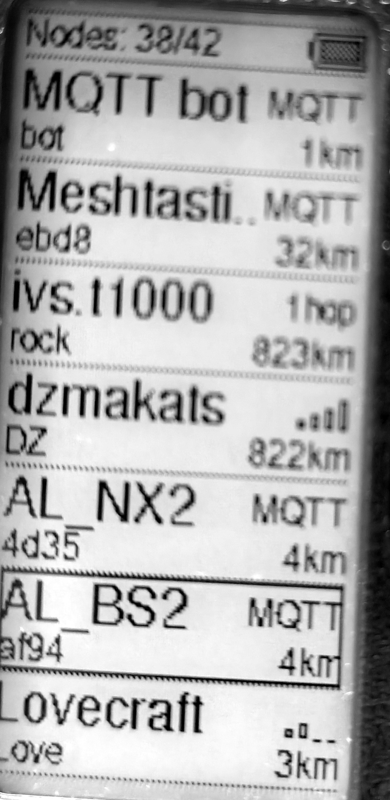
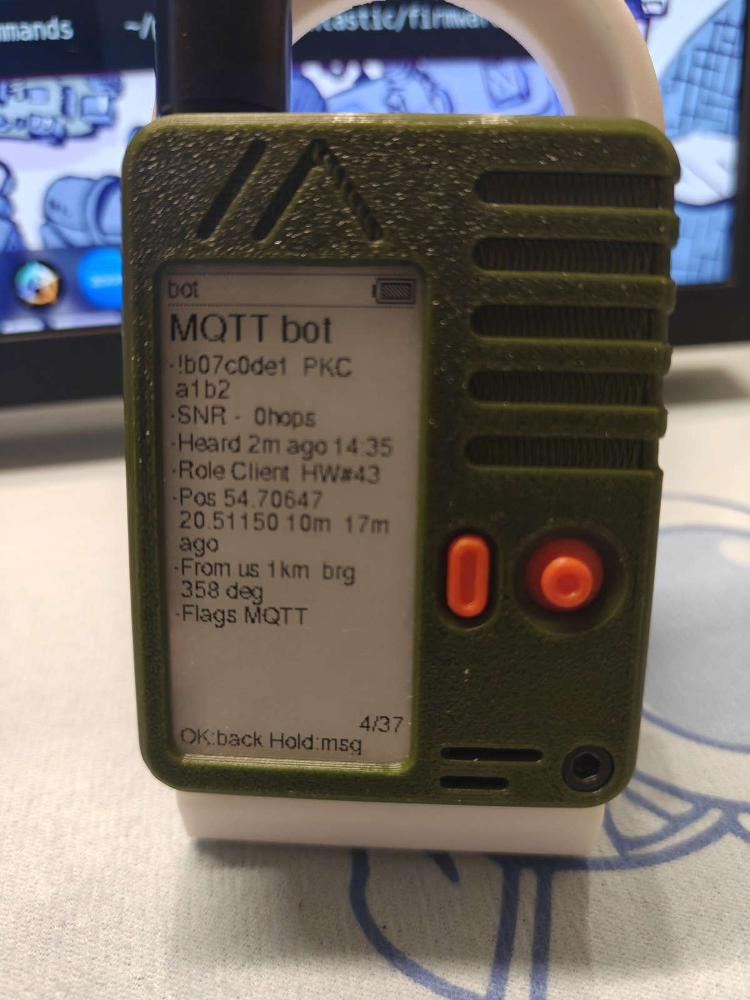
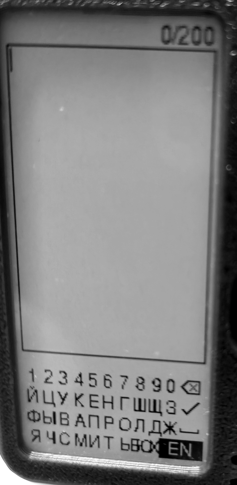
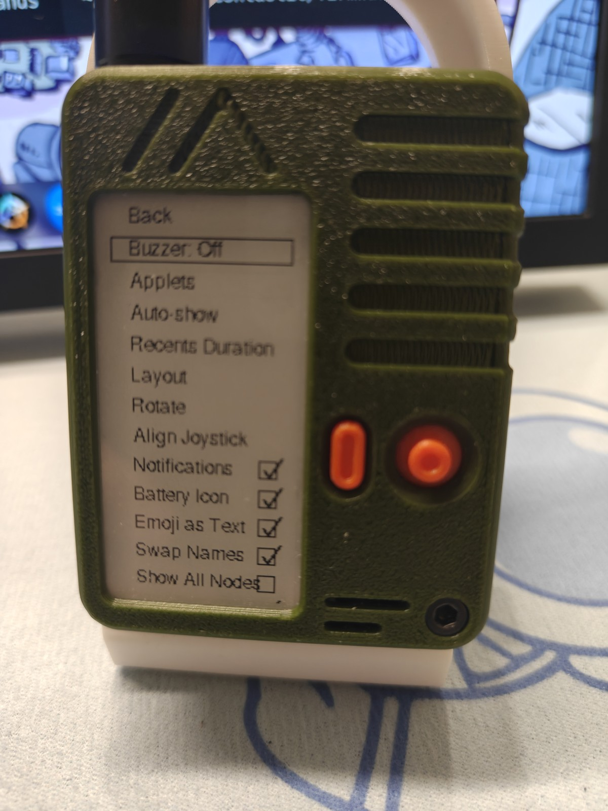
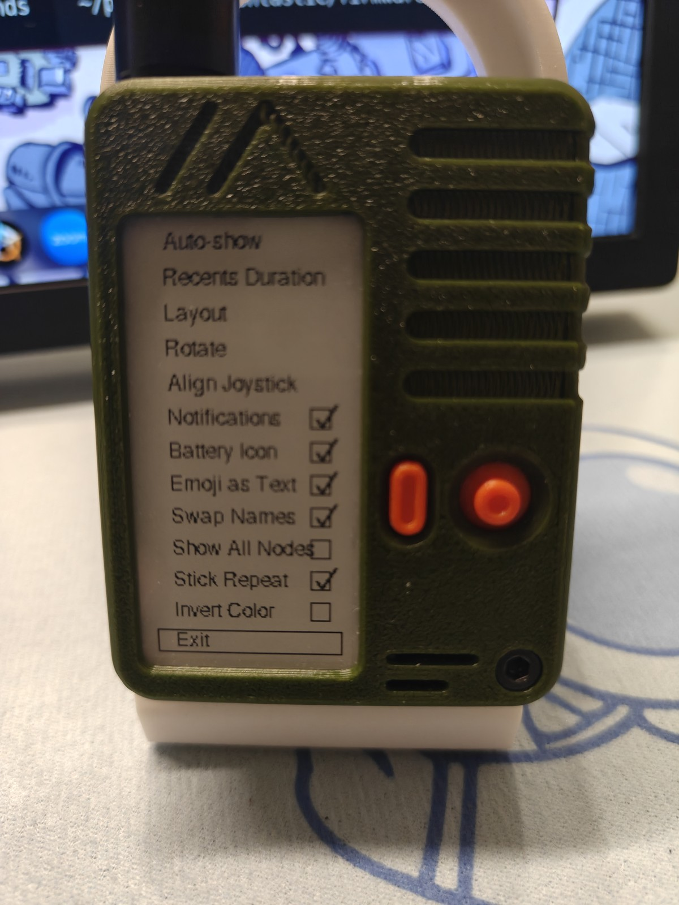
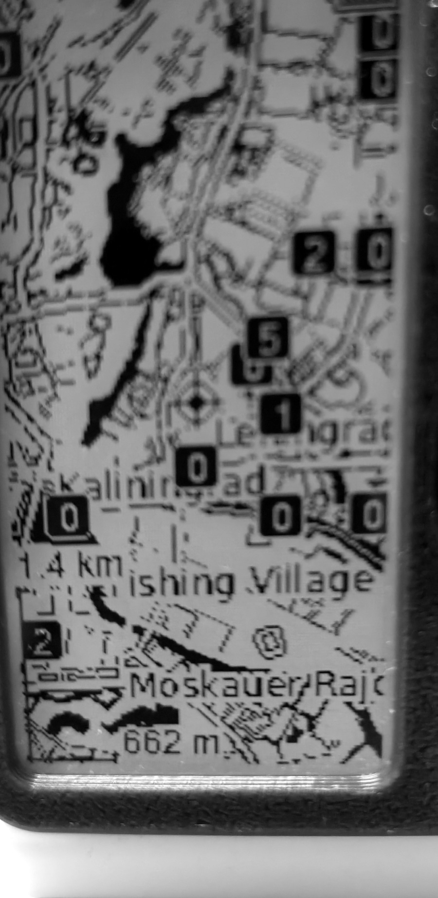
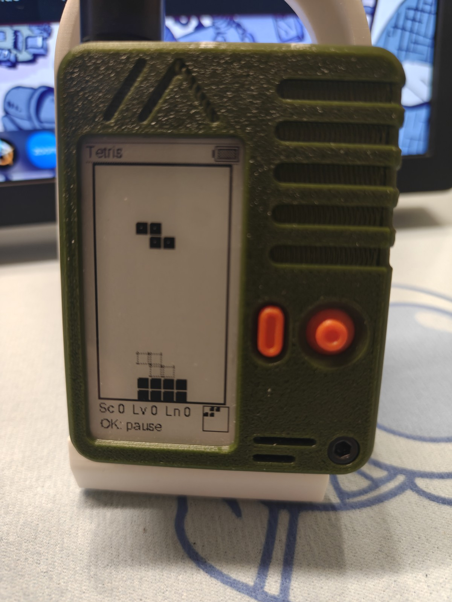
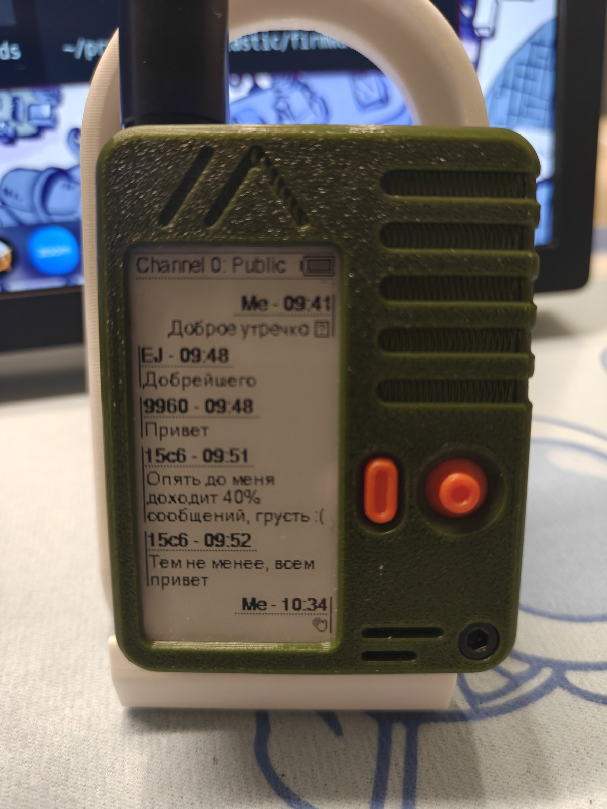

# Meshtastic InkHUD для Seeed Wio Tracker L1 (E-Ink) — кастомная сборка

**TL;DR (EN):** Personal daily-driver fork of Meshtastic firmware 2.8.2 for the Seeed Wio Tracker
L1 E-Ink (nRF52840) with an e-paper InkHUD UI: full Russian support, a baked-in 1:1 city map with
joystick panning, a node browser with detail cards and message composition, hold-to-repeat
navigation, sound modes, and a Tetris applet. This repo holds the prebuilt firmware, the patchset
and the change notes — the source of truth is the upstream fork + `patches/`.

База: **upstream Meshtastic firmware `2.8.2` @ `d5f16191c`**. Всё изменение — четыре коммита,
приложены как `git format-patch` в `patches/` (36 файлов, +5939/−374, из них ~4000 строк —
генерируемая таблица тайлов карты и эмодзи-таблица).

---

## Что внутри (по состоянию на 2026-11-26, тег `l1eink-stable-20261126`)

### Русский язык и текст
- Шрифты InkHUD переведены на WIN1251-варианты FreeSans 6/9/12pt (`-D OLED_RU`).
- Клавиатура: ЙЦУКЕН-раскладка, переключатель RU/EN вместо ESC, ввод кириллицы в сообщения (UTF-8).
- Emoji в телах сообщений заменяются текстом по таблице ~140 частых (`Options → Emoji as Text`).
  В именах нод эмодзи вырезаются; чисто-эмодзи имя показывается своим текстовым именем (`🤖 → bot`);
  пустое имя — hex-ID ноды.

### Карты (без QSPI/SD — всё вшито)
- **Фиксированный зум, без зум-контролов в меню.** Уровень = единственная вшитая сетка тайлов.
- Вшита сетка **z12, 4×4 (22.9 км — Калининград целиком)**, моно-порог, 62 КБ флеша.
  Тайлы генерируются внешним osm-eink-экспортером в `MapTile.h` (формат таблицы — upstream).
- **Панорамирование джойстиком** (полэкрана за шаг, удержание = автоповтор), точка «я» и маркеры
  нод клампятся к краю экрана — не теряются при пане. В меню — «Reset View» после смещения.
- Кламп центра к сетке тайлов: если якорь вида (битый GPS-фикс или центроид mesh) оказывается
  за пределами вшитой сетки — вид ограничивается краем грида, подложка не может пропасть,
  пан не «пружинит».
- Подписи нод на карте: short name рядом с маркером (белая подложка, перекрывающиеся подписи
  пропускаются, нечитаемое имя → `#последние4`).
- Долгое нажатие центра на карте = стандартное меню InkHUD (как у прочих апплетов).
- История: доступ к внешней QSPI NOR (2 МБ LittleFS) для больших карт был реализован и проверен
  (пины в `variant.h` в патчах исправлены на фактическую разводку!), но **откатан**: чтение тайлов
  с ФС в живом использовании подвешивало UI. Карта снова только из flash.

### Nodes (бывший Heard) — полноценный браузер сети
- Список = **все ноды NodeDB**, сортировка по последнему приёму; заголовок `Nodes: показано/всего`.
- Фильтр «мёртвых душ»: скрыты неслышанные >48 ч, кроме избранных (`Options → Show All Nodes`).
- Курсорная навигация (рамка), скролл следует за курсором.
- Клик центра — **карточка ноды**: буллеты с переносом (ничего не режется), максимум данных:
  `!id`, канал, PKC-отпечаток, SNR, hops + next hop, время приёма (относительно + часы), роль,
  HW-модель номером, позиция (координаты/высота/источник/свежесть), дистанция и пеленг от нас,
  флаги (RF/XEDDSA/MQTT/no-msg). В карточке: ↑/↓ — соседние ноды, клик — назад, удержание —
  написать сообщение этой ноде, D13 — назад к списку.
- Правая колонка карточек, как в классическом UI: `Nhops` для ретранслируемых; **бары уровня
  сигнала по порогам SNR** для direct; `MQTT` — только для нод, никогда не слышанных по радио
  (без «мигания» между режимами).

### Ввод и UI
- Кнопка пользователя (D13): короткая = закрыть меню/клавиатуру/карточку, иначе — след. аплет;
  долгая = меню. Все действия с писком зуммера.
- **Автоповтор directions-кнопок джойстика** при удержании (700+ мс пауза, шаг раз в 800 мс —
  согласовано с ~300 мс FAST-рефрешем панели), тумблер `Options → Stick Repeat`.
- Скролл чатов/списков упор в самое старое/новое сообщение, ←/→ больше не листают ленты.
- Звук: `Options → Buzzer: All/Alerts/Off` — честный цикл `config.device.buzzer_mode`
  (Alerts = «ночной»: кнопки молчат, входящие звенят).

### Tetris
- Апплет-игра: колодец почти на весь экран (до 20 рядов в портрете), старт по клику (не
  самозапускается при входе на вкладку), мягкое падение ↓, пауза центром, выход D13,
  корректное гашение нескольких рядов, крупное превью следующей фигуры.

### Технические заметки
- Настройки InkHUD: `SETTINGS_VERSION=5`, 6 резервных байтов в структуре — новые флаги добавляются
  без сброса пользовательских настроек.
- Трекбол: `TB_UP/DOWN/LEFT/RIGHT` в `variant.h` исправлены на фактическую разводку платы —
  при рефакторингах файла **не откатывать** (это уже терялось один раз).
- Сборка: `pio run -e seeed_wio_tracker_L1_eink-inkhud` (PlatformIO, Arduino nRF52 core).
- Прошивка: двойной клик RST (или `stty 1200` на CDC) → скопировать `firmware/*.uf2` на диск
  `TRACKER L1`. UF2-перепрошивка не трогает внутренние настройки и внешнюю flash.
- Размеры образа: Flash 94.4% (769 784 Б), запас ~45 КБ до warm-области, RAM 37.9%.

## Как применить патчи к upstream

```bash
git clone https://github.com/meshtastic/firmware && cd firmware
git checkout d5f16191c
git am patches/0001-*.patch patches/0002-*.patch patches/0003-*.patch patches/0004-*.patch
pio run -e seeed_wio_tracker_L1_eink-inkhud
```

## Скриншоты
Программный захват кадра e-ink-панели в этом билде недоступен, поэтому это фотографии экрана
(без ретуши, метаданные EXIF/GPS срезаны) — `docs/screenshots/`.

<p>
  
  
  
  
</p>
<p>
  
  
  
  
</p>

## Лицензия
Производная Meshtastic firmware — **GPL-3.0** (файл `LICENSE`, как в upstream). Upstream:
https://github.com/meshtastic/firmware

## Дисклеймер
Личная daily-сборка, без гарантий. Пропатченный прошивкой чип — ваша ответственность;
агрессивные опыты с factory reset не рекомендуются: часть фиксов (пины трекбола, имена настроек)
живёт только в этих патчах.
